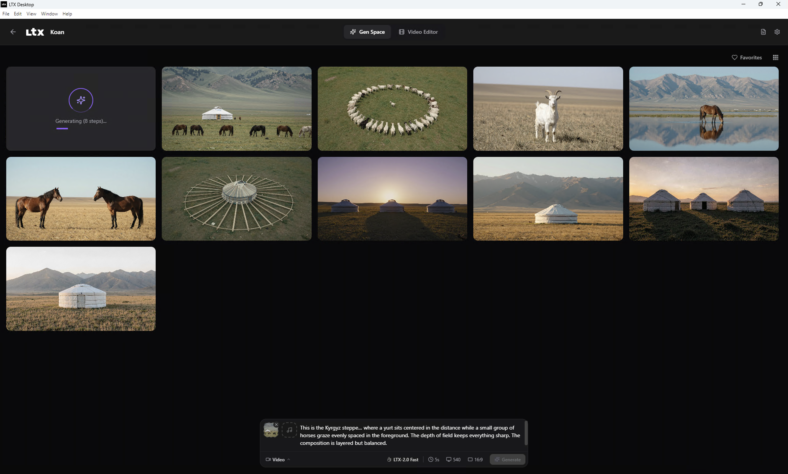

# HyperGen

<p align="center">
  
</p>

HyperGen is an open source desktop studio for AI video generation. It combines
local generation, cloud providers, custom self hosted endpoints, project
history, editing tools, and secure remote control in one application.

> **Preview release:** interfaces and provider support may change before the
> first stable release.

<p align="center">
  
</p>

## Highlights

- Generate video from text, images, and audio.
- Run compatible models locally on supported hardware.
- Connect fal.ai, Replicate, Runway, Luma, Google Veo, or a compatible custom
  endpoint for text to video generation.
- Enter Explore mode without downloading a model or adding an API key.
- Configure provider endpoints and model IDs without exposing saved secrets.
- Manage projects, generated media, history, LoRAs, and editing workflows.
- Use HyperGen from another device on the same Wi-Fi network or through a
  temporary Cloudflare HTTPS address.
- Receive application updates only from the public HyperGen GitHub repository.
- Use the application without product telemetry or analytics.

## Install

Download the package for your platform from
[HyperGen Releases](https://github.com/vjk7989/HyperGen/releases):

- Windows x64: NSIS installer
- Linux x64: AppImage or DEB
- macOS arm64: DMG or ZIP

Preview packages are unsigned. Windows and macOS may display an unknown
publisher warning.

At first launch, choose one of three paths:

1. **Explore HyperGen first** opens the workspace immediately.
2. **Local models** prepares supported on-device generation.
3. **API provider** connects a cloud or self hosted generation service.

Generation is never submitted automatically after setup. If configuration is
missing, HyperGen opens a dismissible setup dialog and waits for the user to
press Generate again.

## Local generation requirements

| Platform | Supported configuration |
| --- | --- |
| Windows 10/11 x64 | NVIDIA CUDA GPU with at least 15 GiB VRAM |
| Linux x64 | NVIDIA CUDA GPU with at least 15 GiB VRAM |
| macOS 13+ arm64 | Apple Silicon with at least 32 GiB total memory |

Local model files are large. Keep at least 72 GB free for the default model
pack. HyperGen stores settings, models, logs, and generated assets in its own
application data directory.

## API providers

HyperGen includes curated text to video adapters for fal.ai, Replicate, Runway,
Luma, and Google Veo. A custom provider can connect to any service that follows
the documented asynchronous REST contract.

Provider keys stay in local application settings. API responses and logs expose
only whether a key is configured. Before generating, review the selected
provider's pricing, retention, model, and content policies.

- [Provider guide](docs/PROVIDERS.md)
- [Custom provider contract](docs/custom-provider.md)
- [Privacy and data flow](docs/PRIVACY.md)

## Remote control

Open **Remote** inside HyperGen and choose:

- **Same Wi-Fi** for access from another device on the local network.
- **Across the internet** for a temporary Cloudflare HTTPS address.

Both modes require the one-time pairing QR code. Internet access runs only
while HyperGen is open and receives a new address after restart. No router port
forwarding is required. See the [remote control guide](docs/remote-lan.md).

## Development

Requirements: Node.js, pnpm, Python 3.13+, `uv`, and Git.

```bash
pnpm setup:dev
pnpm dev
```

Useful checks:

```bash
pnpm typecheck
pnpm lint
pnpm run scripts:test
pnpm backend:test
pnpm build:frontend
```

The application has three layers:

- `frontend/`: React and TypeScript desktop and remote interfaces.
- `electron/`: lifecycle, secure IPC, native integration, and backend process.
- `backend/`: FastAPI services, generation queues, providers, and local model
  execution.

Official Windows, Linux, and macOS packages are built by GitHub Actions. See
the [installer guide](docs/INSTALLER.md).

## Telemetry

HyperGen sends no product telemetry or analytics. Network access occurs only
for features the user chooses, such as provider generation, model downloads,
update checks, and Cloudflare Remote access. See the
[telemetry policy](docs/TELEMETRY.md).

## Documentation

- [Provider setup](docs/PROVIDERS.md)
- [Custom endpoint protocol](docs/custom-provider.md)
- [Remote access](docs/remote-lan.md)
- [Privacy](docs/PRIVACY.md)
- [Telemetry policy](docs/TELEMETRY.md)
- [Contributing](docs/CONTRIBUTING.md)
- [Backend architecture](backend/architecture.md)

## License

Apache-2.0. See [LICENSE.txt](LICENSE.txt).

Third-party software, model, and dependency notices are recorded in
[NOTICES.md](NOTICES.md). Downloaded model files may have additional terms.
